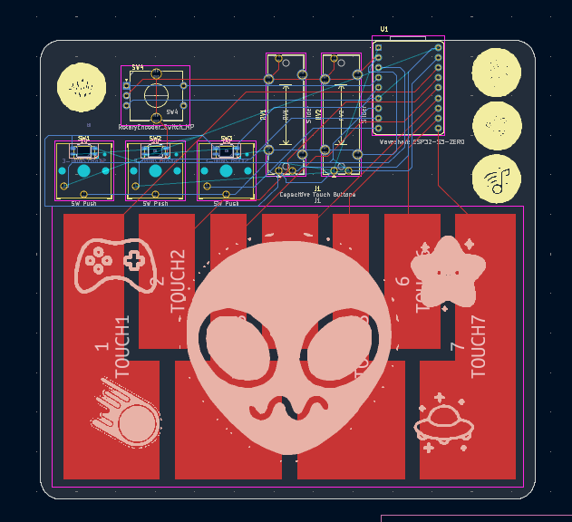
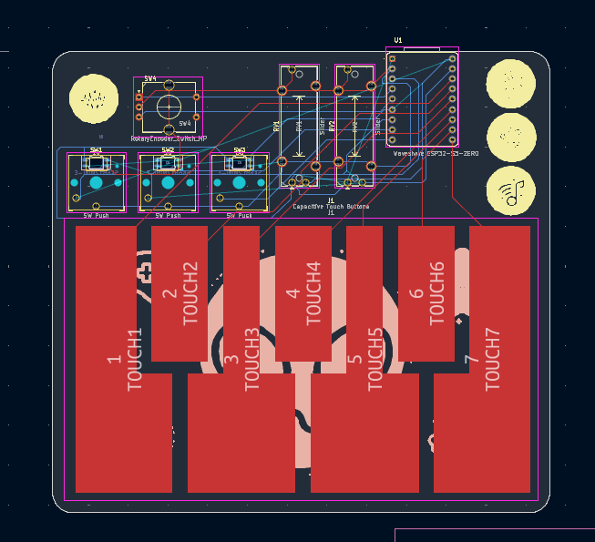
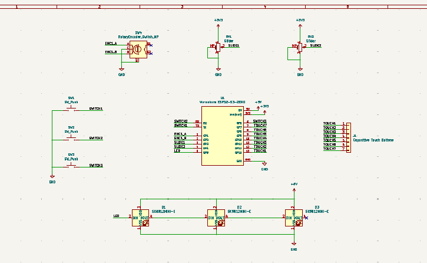

# midi-keyboard
A custom MIDI keyboard with switches, sliders, rotary encoders, neo pixels, and capacitive touch!
Once it gets built, it will play music!

## parts used
- EC11 Rotary Encoders
- SK6812 MINI-E Neopixels
- Bourns Slide Potentiometers
- Kailh Choc Low-Profile Switches

## project images

Here is the back of the silkscreen. Here I have added space themed pictures using KiCads iamge converter.

Here is the front of the silkscreen. I continued witht the same theme, however all images are in circles.

This is what my schematic editor looked like once I was done

Hack Life Week 3 Project - DESIGN YOUR INSTRUMENT
